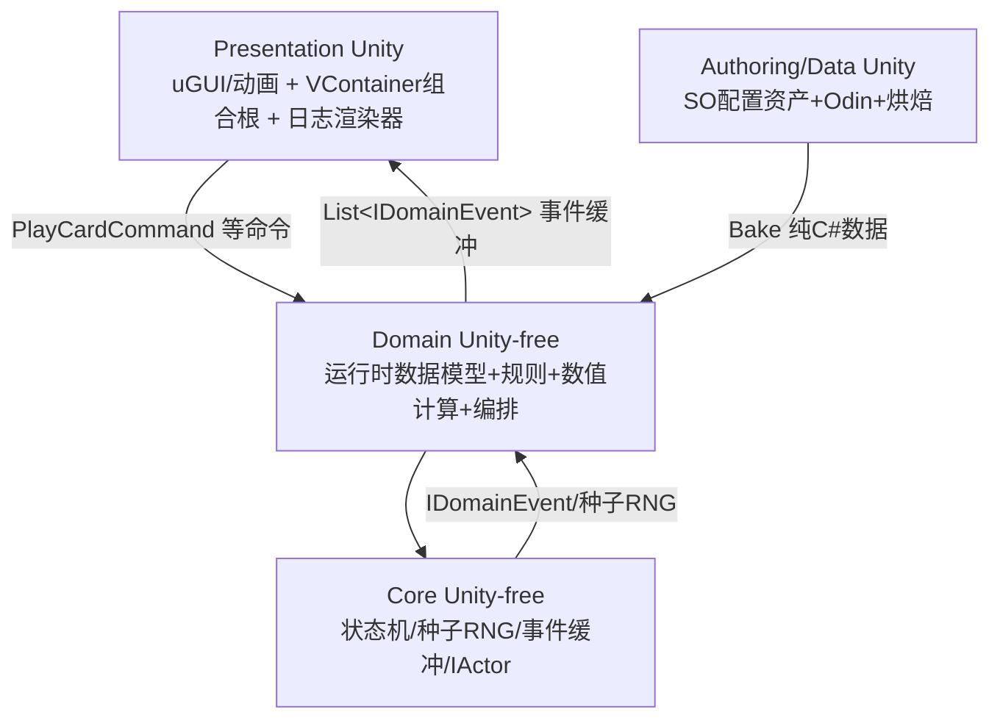

## 产品概述
为《梦境守望》（Unity 2022.3 卡牌肉鸽毕设）撰写一份统一参考文档：`Docs/04-项目实现顺序与系统解耦设计.md`。文档以 15 轮咨询共识为唯一架构真源，明确四层程序集（Core/Domain/Data/Presentation）的职责边界、解耦方式、通信机制与数据流向，并给出 P0~P6 实现顺序（P0 为用户可照做的改造待办清单）。

## 核心功能
- **文档定位与决策记录**：登记 15 项已锁决策，声明对项目旧蓝图共识（五件套含 Simulation、泛型事件总线承载遗物钩子、VContainer 在 Application、M5 无头模拟）的取代关系，消除两份真相
- **现有插件与代码盘点**：第三方插件隔离等级表、10 个既有 .cs 逐个处置表、编辑器工具、空目录、失效文件
- **系统解耦设计**：四程序集依赖链（无环）、各层职责与禁入清单、三段式通信（命令进/同步结算/事件缓冲出）、IDomainEvent 事件清单、StS 动作队列与本作的关键差异
- **交互流程与数据流向**：单回合时序（Mermaid）、配置资产到运行时数据的烘焙流、命令上行与事件下行两条通道
- **实现顺序 P0~P6**：P0 九项可照做待办（含 asmdef 改名、noEngineReferences、VContainer 下移、代码迁移），P1~P6 目标与依赖
- **扩展点与维护注意事项**：加词条/遗物/事件的扩展路径、Domain 软隔离残余风险、既有代码缺陷清单、裁剪顺序

## 技术方案
### 交付形态
单个 Markdown 文档，落点 `d:/Unity/Projects/DreamKeep/Docs/04-项目实现顺序与系统解耦设计.md`（与设计稿编号衔接，不进 Assets/ 避免 Unity 导入）。纯文字 + Mermaid 架构图/时序图 + 表格，**不写任何代码实现**（本次范围：只写文档，代码一行不动）。

### 章节结构（对应用户要求的 5 项内容）
| 章节 | 对应需求 |
|---|---|
| §0 文档定位与决策记录（取代旧共识） | 前置 |
| §1 现有插件与代码盘点 | 需求 1 |
| §2 系统解耦设计 | 需求 3 |
| §3 系统间交互流程与数据流向 | 需求 4 |
| §4 实现顺序 P0~P6（P0 待办清单） | 需求 2 |
| §5 扩展点与未来维护注意事项 | 需求 5 |

### 必须承载的既定架构（共识产物，写死不开放）

依赖链：`Core ← Domain ← Data ← Presentation`（无环）；Core 硬隔离（overrideReferences 白名单），Domain 软隔离（noEngineReferences:true 挡 UnityEngine，第三方靠约定）；通信三段式，遗物钩子为结算管线拦截点而非事件总线广播。

### 写作纪律
- 设计稿章节号（§4.1 edge1/§4.2 edge6/§4.6/§5/§8）作交叉引用锚点，不复制原文
- 命名遵守用户编码规范（_camelCase 私有字段、E 前缀枚举、SO_/UI_ 前缀、一脚本一类型、#region 仅包对外 API、构造注入 private readonly）
- StS 数值曲线可借鉴比例关系、威胁节奏（纵深压境）需自调——明确写入
- 平衡验证已砍，相关内容标注"已裁剪"并说明理由，不留悬空引用
	
