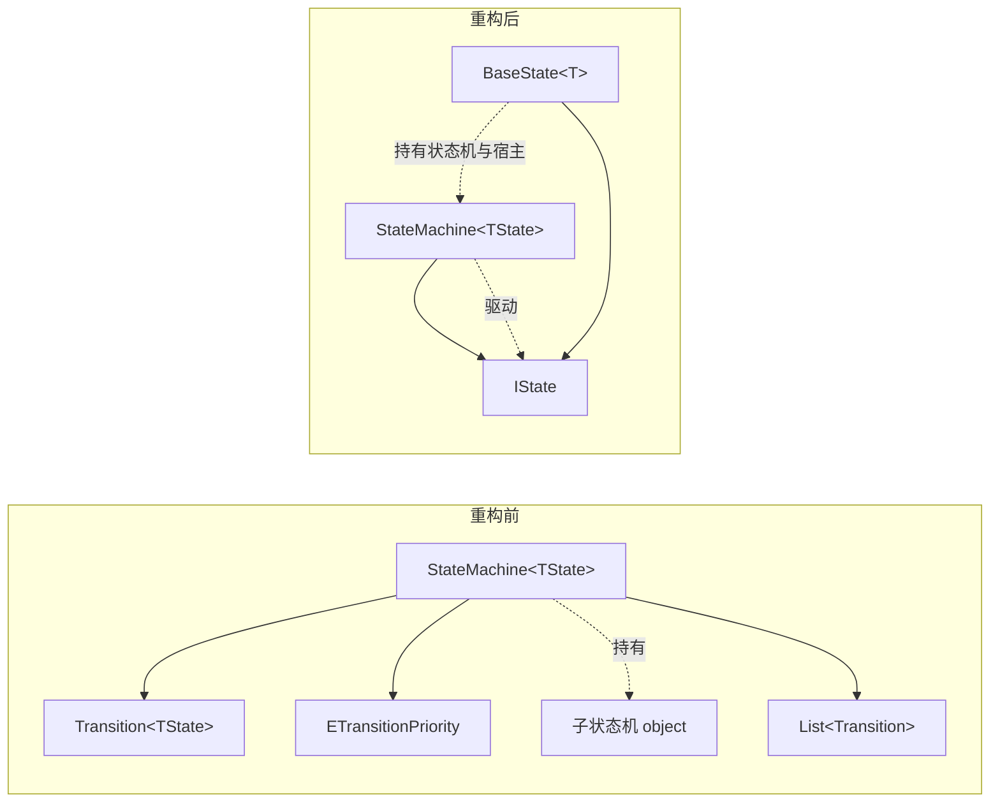

## 产品概述
对 DreamKeep 项目中自研的有限状态机模块（`Assets/_Scripts/Core/FSM/`）做减法重构。该模块当前约 210 行、5 个文件，包含分层子状态机与表驱动条件转换两套能力，但项目至今零处使用。本次按其实际需要裁剪为「单层 + 状态自决转换」的极简实现。

## 核心需求
- **删除分层状态机能力**：移除 `SetChildFsm` / `GetChildFsm` 及子状态机存储、驱动相关的全部字段与逻辑
- **删除表驱动条件转换系统**：整个删除 `Transition.cs`、`ETransitionPriority.cs` 两个文件，以及 `AddTransition`、`AddAnyTransition`、`InsertSorted`、`EvaluateTransitions`
- **转换改为状态自决**：由状态内部调用 `ChangeState` 决定切换时机
- **精简状态机成员**：保留 `CurrentState`、`ChangeState`、`Initialize`、`OnStateChanged`、`Update`；删除 `PreviousState`、`FixedUpdate`
- **同步精简生命周期**：`IState`、`BaseState<T>` 移除 `FixedUpdate`
- **统一命名空间**：`GJFramework.FSM` 改为 `_DreamKeep.Core`，与 asmdef 的 `rootNamespace` 对齐
- **增加切换守卫**：`ChangeState` 目标与当前状态相同时直接返回，避免同帧重复切换造成的 `Exit` → `Enter` 抖动
- **清理残留**：删除文件的同时删除同名 `.meta`，并全局校验无残留引用

## 不做的事
- 不新增任何使用点（玩家控制器、敌人 AI、回合流程等均不在本次范围）
- 不调整程序集划分（`_DreamKeep.Core` 保持 `noEngineReferences: true`）
- 不合并 `IState` 与 `BaseState<T>`（用户明确未选该方案，接口必须保留）


## 技术栈
- 引擎与语言：Unity（C#）
- 程序集：`_DreamKeep.Core`（`rootNamespace: _DreamKeep.Core`，`noEngineReferences: true`，即不依赖 `UnityEngine` 的纯逻辑程序集）
- 依赖：仅 `System`、`System.Collections.Generic`，无第三方库

## 实现方案

### 总体策略
采用**原地收缩式重构**而非引入新抽象：在既有 `StateMachine<TState>` / `BaseState<T>` / `IState` 三件套基础上做纯删减与命名空间替换，不改变任何对外契约的形状（属性名、方法签名、字段语义保持不变），因此零调用方影响、零迁移成本。

### 关键技术决策与权衡

**决策一：状态自决 vs 表驱动转换**
两者原本并存，本次保留状态自决、删除表驱动。理由：
- 项目是卡牌构筑 Roguelike，真正吃重的是**回合流程状态机**（回合开始 → 出牌 → 结束回合 → 敌方行动 → 结算），是线性、单层、由当前阶段自己决定「什么时候算完并移交下一阶段」的结构，转换时机天然内聚在状态里
- 表驱动 + 优先级排序（`Transition` + `ETransitionPriority` + `InsertSorted` + `EvaluateTransitions` 合计约 70 行）是为「角色 AI 多条件竞争」设计的，此处属于过度设计
- 代价：`AddAnyTransition` 这类「任意状态下响应死亡/受击」的全局能力消失。缓解方式：死亡等高优先级中断逻辑，在宿主（`_owner`）侧统一处理后再调 `ChangeState`，或由各状态基类共用一段前置判断，**比优先级表更直观**

**决策二：`PreviousState` 删除**
无任何使用点。真需要回溯时，`OnStateChanged` 的 `from` 参数已提供同样信息，属于标准 DRY 取舍。

**决策三：`FixedUpdate` 删除**
回合制卡牌游戏无物理帧驱动需求，状态机不需要双时钟。若将来出现需求，加回来的成本是一次两行改动，不构成 YAGNI 风险。

**决策四：`ChangeState` 加同状态守卫**
表驱动删除后，`ChangeState` 成为唯一入口，风险从「集中式条件表」转移到「分散在各状态 `Update` 中的调用点」。一个状态内多分支并列、或内部判断与外部事件（如伤害事件）同帧叠加时，可能对同一状态连续调用，导致 `Exit` → `Enter` 抖动、计时器与动画触发器被重置两次。守卫成本 1 行，收益是消除整类隐患。

### 复杂度与性能
- 重构后 `Update` 为 O(1)（原为 O(1) + O(n) 转换表遍历，n 为注册的转换规则数）
- `ChangeState` 为 O(1)
- 删除 `_transitions` 列表与三个子层委托字段后，`StateMachine` 实例从「1 个 List + 3 个引用」降为「1 个状态引用 + 1 个事件委托」，堆分配与 GC 压力下降；原 `EvaluateTransitions` 每帧 `foreach` 的结构已彻底移除
- 无热路径瓶颈

## 实现要点（执行细节）

1. **`.meta` 必须成对删除**：删除 `Transition.cs`、`ETransitionPriority.cs` 时同步删除 `Transition.cs.meta`、`ETransitionPriority.cs.meta`，否则 Unity 会残留孤立 meta 文件并在控制台告警。用户删除 `FSMREADME.md` 时已连 meta 一起处理，沿用该做法。
2. **不得引入 `UnityEngine`**：`_DreamKeep.Core.asmdef` 为 `noEngineReferences: true`，精简后只保留 `System` 与 `System.Collections.Generic` 两个 using（`System.Collections.Generic` 因 `EqualityComparer<TState>.Default` 仍需要）。
3. **严格遵守用户编码规范**：protected 字段 `_fieldName`；方法参数 `小驼峰_`；只读属性与单行方法一律 `=>`；单行 `if` 省略花括号；对外 public 方法用单层 `#region` 包裹，私有方法不包裹；类注释用 `<summary>`；一个脚本一个类型。
4. **注释同步修订**：`StateMachine` 的类注释原文描述的是分层行为，必须改写为单层语义，否则留下误导性文档。
5. **影响面控制**：全项目对该 FSM 的使用点为 0（`Application` / `Presentation` / `Simulation` 三个程序集目录为空），删除不构成破坏性变更，无需改动调用方、无需改任何 asmdef。

## 架构设计

重构前后对比（同属 `_DreamKeep.Core` 程序集，模块边界不变）：



数据流（重构后）：

```mermaid
sequenceDiagram
    participant 宿主 as 宿主 MonoBehaviour
    participant 机 as StateMachine&lt;TState&gt;
    participant 态 as 当前状态 / IState
    宿主->>机: Initialize(初始状态)
    机->>态: Enter()
    loop 每帧
        宿主->>机: Update()
        机->>态: Update()
        态->>机: ChangeState(下一状态)  // 状态自决
        机->>态: Exit()
        机->>机: 守卫检查（同状态则终止）
        机->>态: 新状态 Enter()
        机-->>宿主: OnStateChanged(from, to)
    end
```

职责划分：
- `IState`：状态生命周期契约（`Enter` / `Update` / `Exit`）
- `BaseState<T>`：状态基类，为具体状态提供 `_myStateMachine`（自决转换入口）与 `_owner`（宿主引用）
- `StateMachine<TState>`：只负责「持有当前状态、驱动 `Update`、执行切换、广播事件」

## 目录结构

```
Assets/_Scripts/Core/FSM/
├── StateMachine.cs              # [MODIFY] 单层状态机核心。删除分层全部字段与 SetChildFsm/GetChildFsm，删除 _transitions 与 AddTransition/AddAnyTransition/InsertSorted/EvaluateTransitions，删除 PreviousState 与 FixedUpdate；ChangeState 增加「目标与当前状态相同则 return」守卫；命名空间 GJFramework.FSM 改为 _DreamKeep.Core；类注释改写为单层语义。153 行 → 约 28 行。
├── IState.cs                     # [MODIFY] 状态接口。删除 FixedUpdate；命名空间改为 _DreamKeep.Core；补 <summary> 类注释。10 行 → 约 12 行。
├── BaseState.cs                  # [MODIFY] 状态基类。删除 FixedUpdate 虚方法；行注释改为标准 <summary>；命名空间改为 _DreamKeep.Core。保留 _myStateMachine 与 _owner 两个 protected 字段及构造函数注入。20 行 → 约 20 行。
├── Transition.cs                 # [DELETE] 条件转换规则结构体，随表驱动转换系统一并移除。
├── Transition.cs.meta            # [DELETE] 配套 meta，必须成对删除。
├── ETransitionPriority.cs        # [DELETE] 转换优先级枚举，随表驱动转换系统一并移除。
└── ETransitionPriority.cs.meta   # [DELETE] 配套 meta，必须成对删除。
```

未改动（仅说明，勿动）：
- `Assets/_Scripts/Core/_DreamKeep.Core.asmdef`（命名空间改后与 `rootNamespace` 已一致，无需调整）
- `Assets/_Scripts/Core/FSM/` 目录本身保留，作为物理分组（与 Data 层 `Data/Affix/Concrete/` 子目录但命名空间为 `_DreamKeep.Data` 的惯例一致）

## 关键代码结构

重构后 `StateMachine<TState>` 对外契约（三个 public 方法 + 一个属性 + 一个事件）：

```csharp
namespace _DreamKeep.Core
{
    /// <summary>
    /// 单层状态机。状态转换由状态内部调用 ChangeState 自决,不提供分层子状态机与表驱动条件转换。
    /// </summary>
    public class StateMachine<TState> where TState : IState
    {
        /// <summary>当前状态</summary>
        public TState CurrentState { get; private set; }
        /// <summary>状态切换事件,参数为(切换前状态, 切换后状态)</summary>
        public Action<TState, TState> OnStateChanged;

        #region 初始化状态机
        public void Initialize(TState state_);
        #endregion

        #region 切换状态,目标与当前状态相同时视为无操作
        public void ChangeState(TState newState_);
        #endregion

        #region Update驱动
        public void Update();
        #endregion
    }
}
```

`ChangeState` 内部顺序（须严格保持，避免行为回归）：
1. 守卫：`EqualityComparer<TState>.Default.Equals(newState_, CurrentState)` → 直接 return
2. 暂存 `from = CurrentState`
3. `CurrentState?.Exit()`
4. 赋值新状态
5. `CurrentState?.Enter()`
6. `OnStateChanged?.Invoke(from, newState_)`

`IState` 与 `BaseState<T>` 保持原形状，仅移除 `FixedUpdate`：

```csharp
public interface IState
{
    void Enter();
    void Update();
    void Exit();
}

public abstract class BaseState<T> : IState where T : class
{
    protected StateMachine<BaseState<T>> _myStateMachine;
    protected T _owner;

    protected BaseState(StateMachine<BaseState<T>> stateMachine_, T owner_);

    public virtual void Enter() { }
    public virtual void Update() { }
    public virtual void Exit() { }
}
```

