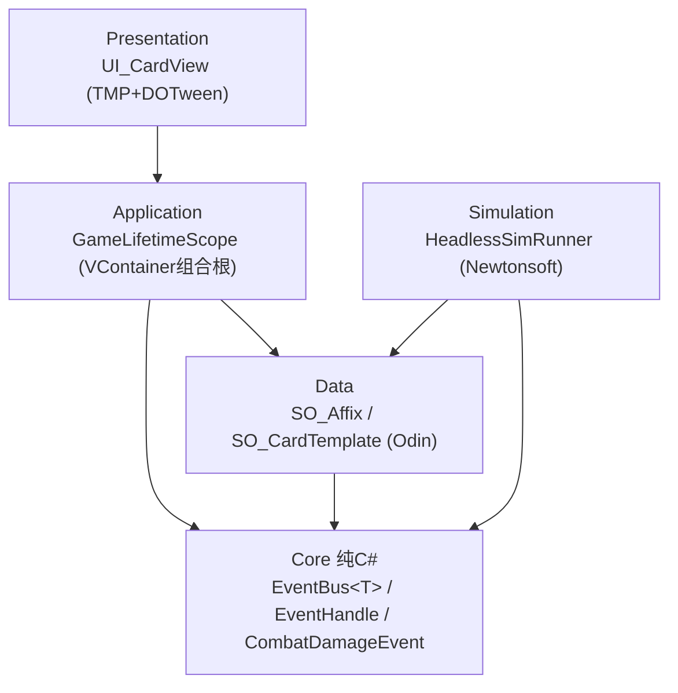

## Product Overview
为《梦境守望》已建好的 5 个程序集（Core、Data、Application、Presentation、Simulation）编写种子代码：每个程序集 1~3 个贴合最终架构的可演进骨架脚本，脚本头部注释标明“本程序集职责 + 用到的插件知识”，让用户通过阅读真实代码理解分层与插件用法。

## Core Features
- 修正 asmdef 依赖：显式 references + Core 纯 C# 隔离（noEngineReferences: true）
- 删除不采用的 _DreamKeep.Editor.asmdef（编辑器工具走 Unity 自动 Assembly-CSharp-Editor）
- Core：泛型事件总线 EventBus&lt;T&gt;（M0 验收项雏形）+ 可注销订阅句柄 EventHandle + 不可变 CombatDamageEvent 示例
- Data：SO_Affix 词条 SO（Odin 特性演示）+ SO_CardTemplate 卡模板（SO 资产互引）
- Application：GameLifetimeScope（VContainer 组合根，挂场景 GameRoot 作为唯一入口）
- Presentation：UI_CardView 卡牌视图灰盒雏形（TMP + DOTween + 构造注入）
- Simulation：HeadlessSimRunner 无头模拟雏形（随机策略跑 N 局 + Newtonsoft.Json 统计输出）


## Tech Stack
- Unity 2022.3.62 LTS，内置渲染管线
- 架构：纯 C# Core + 薄表现层，依赖方向单向向下（asmdef 编译期强制）
- 插件：VContainer 1.19.0（DI，仅 Application 层）、UniTask（异步）、DOTween（表现动画，核心 DLL Auto Reference 免引用，显式引 DOTween.Modules）、Newtonsoft.Json 3.2.2（预编译 DLL，Auto Reference 自动生效）、Odin Inspector（Data 层 SO 特性）、uGUI + TMP（表现层）

## Implementation Approach
- 种子代码即架构雏形：事件总线按文档 §2.4 设计（不可变 struct 事件、订阅返回句柄、可注销防泄漏）；VContainer 只出现在 Application 的 LifetimeScope；Core 内零 UnityEngine 类型（数值只用 int/float）
- GameRoot 单入口合理：场景建空 GameObject 挂 GameLifetimeScope，VContainer 在其 Start 注入所有 UI_ 组件，天然构成唯一组合根，符合文档 §2.5“战斗作用域承载战斗态”的扩展路径
- 依赖表定稿：Core=无；Data=Core；Application=Core、Data、VContainer、UniTask；Presentation=Core、Data、Application、DOTween.Modules；Simulation=Core、Data
- 命名/写法全部遵守用户规范：_camelCase 私有字段、E 前缀枚举、SO_/UI_ 前缀、参数尾下划线、#region 仅包对外 API、表达式主体优先、一脚本一类型

## Architecture Design



## Directory Structure
```
Assets/_Scripts/
├── Core/
│   ├── _DreamKeep.Core.asmdef      # [MODIFY] noEngineReferences:true，保持无 references
│   ├── EventBus.cs                 # [NEW] 泛型发布/订阅总线：Publish/Subscribe，订阅返回 EventHandle；纯 C#，无 UnityEngine、无 Debug.Log
│   ├── EventHandle.cs              # [NEW] 订阅句柄 struct，Dispose 即注销，供 UI_ 类 OnDestroy 成对注销
│   └── CombatDamageEvent.cs        # [NEW] 不可变事件 struct 示例（来源/目标/数值/是否穿透），Core 事件家族的样板
├── Data/
│   ├── _DreamKeep.Data.asmdef      # [MODIFY] references: Core
│   ├── SO_Affix.cs                 # [NEW] 词条 SO 示例：名称/类型枚举 EAffixType/伤害/格挡字段 + Odin [LabelText][PreviewIfNeeded] 演示
│   └── SO_CardTemplate.cs          # [NEW] 卡模板 SO：卡名/费用/耗能/SO_Affix 引用列表，演示 SO 资产互引
├── Application/
│   ├── _DreamKeep.Application.asmdef # [MODIFY] references: Core、Data、VContainer、UniTask
│   └── GameLifetimeScope.cs        # [NEW] 继承 LifetimeScope 的组合根：注册 EventBus 单例与示例服务，Configure 分发注入
├── Presentation/
│   ├── _DreamKeep.Presentation.asmdef # [MODIFY] references: Core、Data、Application、DOTween.Modules
│   └── UI_CardView.cs              # [NEW] UI_ 前缀卡牌视图：TMP 文本刷新 + DOTween 悬浮/入场动画 + 构造注入事件总线订阅
├── Simulation/
│   ├── _DreamKeep.Simulation.asmdef # [MODIFY] references: Core、Data
│   └── HeadlessSimRunner.cs        # [NEW] 纯 C# 无头模拟雏形：随机策略跑 N 局，Newtonsoft 序列化统计 JSON
└── Editor/                         # [DELETE] 删除 _DreamKeep.Editor.asmdef、文件夹及 .meta
```

## Implementation Notes
- Core 内禁止出现 UnityEngine/MonoBehaviour/Debug.Log（文档 §7.1 红线），事件总线测试可在 M0 补 EditMode 测试
- Presentation 的 UI_CardView 不写业务规则，只做“订阅事件→播表现”与“输入→命令”翻译
- 依赖注入走构造函数注入，私有依赖字段统一 private readonly
- 每个 .cs 文件头部用注释块写明：本程序集职责 / 本脚本演示的插件知识，这正是用户要求的教学载体

