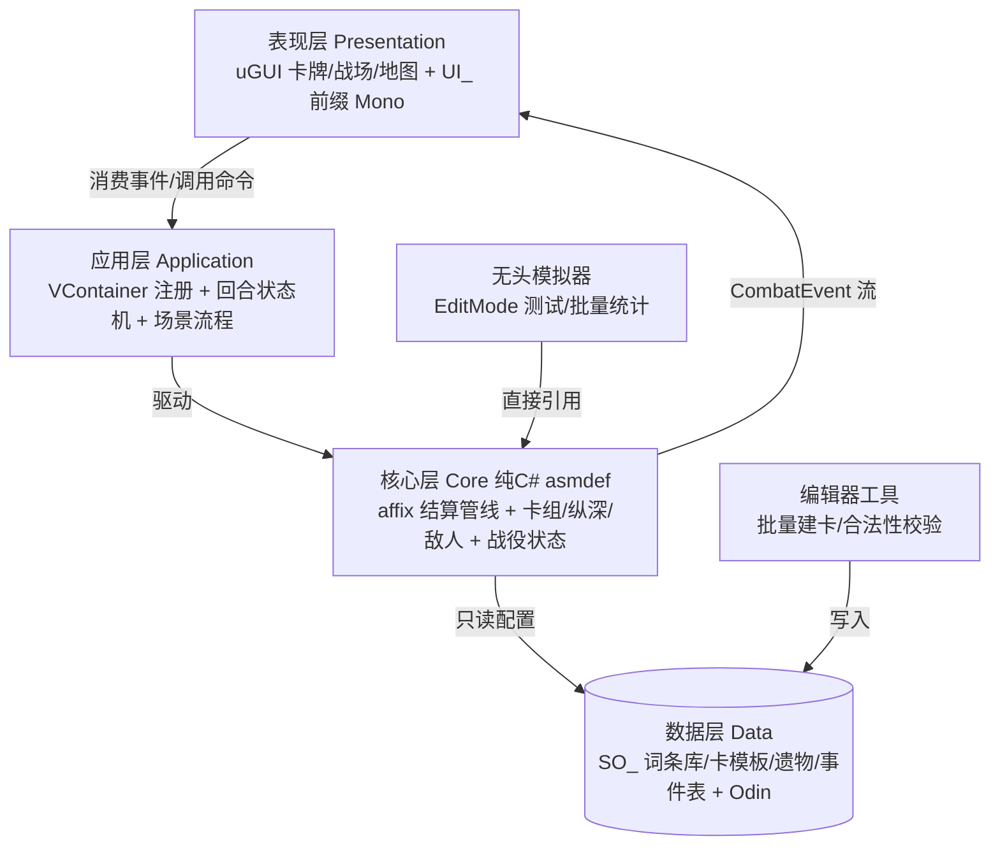

## 需求概述
基于《梦境守望》设计稿 v3.5 与咨询共识，产出一份施工蓝图文档：`D:\Unity\Projects\DreamKeep\制作流程与技术选型.md`（与设计稿并列存放），服务单人毕设全周期，核心目标是“架构不腐化、工期不失控”。

## 核心内容
- **制作方向**：从设计稿提炼开发顺序原则——垂直切片、逻辑先行美术后置、永保一局闭环可玩
- **详细制作流程**：M0~M6 阶段制相对工期（每阶段：目标/产出物/验收标准），设计稿 §7 全部 [PLACEHOLDER] 参数明确标注“由 M5 无头模拟锁定”
- **架构方案**：纯 C# 核心层 + uGUI 薄表现层（asmdef 程序集隔离）、敌我共用 affix 统一结算管线、泛型事件总线承载遗物钩子（战斗开始/回合开始/打牌后/受击后/战斗胜利）
- **防石山守则**：用户编码规范在本项目的落地细则（目录/命名/依赖方向/测试边界/每脚本一类型）
- **插件推荐**：按模块列推荐插件与理由 + 内置管线氛围的轻量替代方案
- **素材采购规格**：卡面/敌人/Boss/图标/场景氛围图的尺寸、格式、命名、数量清单（用户自行采购，买回即入管线）
- **风险对照**：裁剪顺序（对齐设计稿 §5）、无头模拟验证节点、失败信号回退动作


## 交付物形态
单个 Markdown 文档，纯文字 + Mermaid 架构图 + 表格，不涉及任何代码实现。

## 已锁定技术栈（文档核心记录项，全部经咨询共识确认）
| 模块 | 选型 | 依据 |
|---|---|---|
| DI 框架 | VContainer | 活跃维护、与“普通 C# 类 + 构造函数注入”编码规范同构 |
| UI | uGUI + TMP（已装） | 拖拽/悬停/tip 交互生态最成熟 |
| 渲染 | 内置管线 | 用户拍板；氛围走粒子 + 简单 shader + 免费 VFX 资源 |
| 数据 | 原生 ScriptableObject + Odin Inspector | 用户已有 Odin；词条组合工作流效率最大化 |
| 异步/事件 | UniTask + 自研泛型事件总线 | 回合制无需响应式抽象；遗物钩子 = 固定事件点订阅 |
| 动画 | DOTween 免费版 | uGUI 无缝集成 |
| 序列化/存档 | Newtonsoft Json（UPM: com.unity.nuget.newtonsoft-json） | 官方包，零成本 |
| 测试 | Unity Test Framework（已装）+ 核心层 EditMode 测试 | 支撑 §6 无头模拟 |

## 架构设计（文档将收录的分层图）

关键约束：核心层不引用 UnityEngine 主模块以外的类型（仅用 Mathf 等纯结构），保证无头模拟可运行；依赖方向单向向下；事件总线为核心层唯一对外出口。

## 目录结构
```
D:\Unity\Projects\DreamKeep\
├── 梦境守望.md                    # [已有] 设计稿 v3.5（文档的引用源头）
└── 制作流程与技术选型.md          # [NEW] 本次唯一交付物
```

## 执行要点
- 文档中所有代码示例与命名必须遵守用户编码规范（_camelCase 私有字段、E 前缀枚举、SO_/UI_ 前缀、一脚本一类型、#region 仅包对外 API）
- 设计稿章节号（§3.5/§4.1/§6 等）作为交叉引用锚点，不复制原文
- M 阶段排期按“熟练单人·每周 20h”给预估周数，不绑日历
- 插件清单区分“必装/可选/不推荐”，避免工具堆砌反成负担

