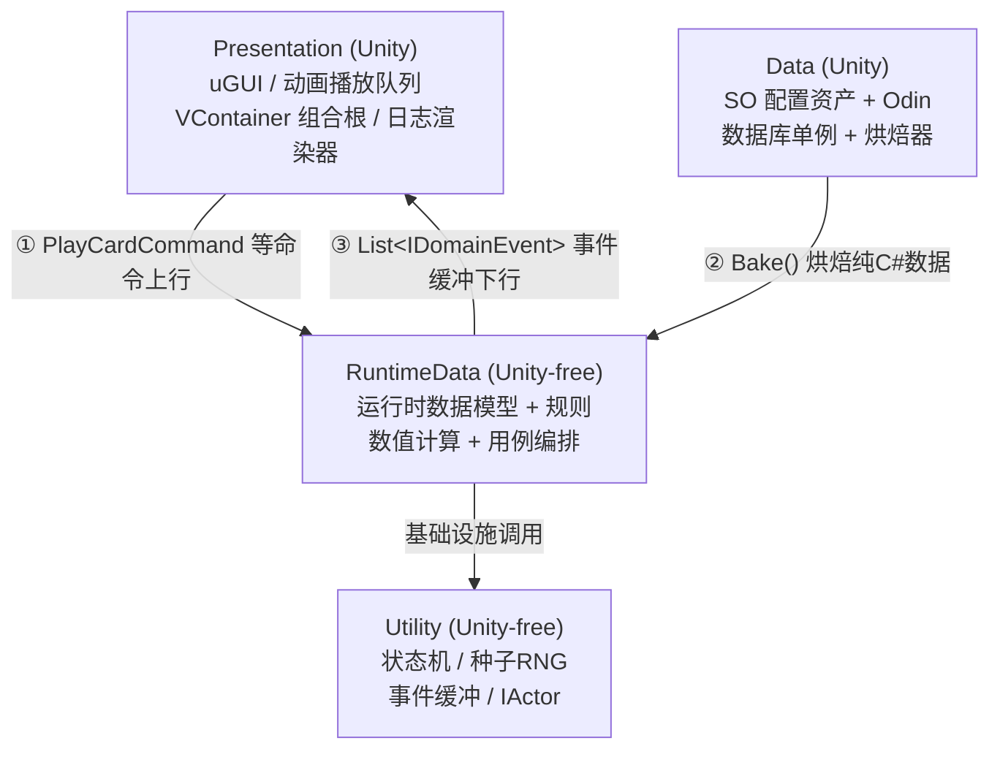
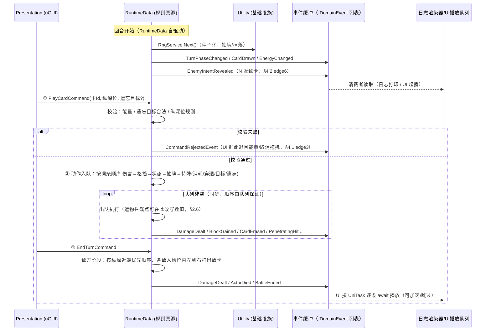
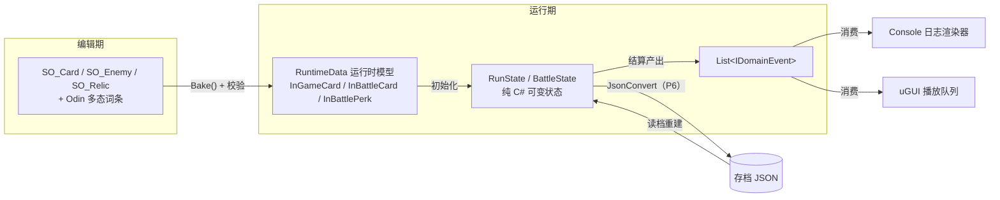

# 04 项目实现顺序与系统解耦设计

> 版本 v1.0 · 2026-09-05
> 定位：《梦境守望》后续开发与沟通的**统一架构参考**。所有"代码放哪、依赖谁、怎么通信、先做什么"的问题，以本文为准。
> 引用源：`03-毕业设计方案-卡牌肉鸽融合成熟玩法.md`（v3.5 纯设计稿，下称"设计稿"），章节号 §x.x 作交叉引用锚点，不复制原文。
> 性质：本文含架构定案与待办清单，**不含代码实现**。§4.1 的 P0 待办由主理人自行执行。
> 决策方式：15 轮逐项咨询共识，逐条记录于 §0.2，不接受无记录的口头改动。

---

## 0. 文档定位与决策记录

### 0.1 一句话总纲

> **四个程序集、一条无环依赖链、三段式通信；Utility 硬隔离，RuntimeData 软隔离；规则与状态只存在一处，表现层只读不回写。**

### 0.2 决策记录（18 项，全部经咨询共识拍板）

| # | 决策项 | 结论 | 一句话理由 |
|---|---|---|---|
| D1 | "插件系统"章节所指 | 只写**第三方插件隔离约定**；词条/遗物注册式扩展机制并入各自系统顺带写，不单独立章 | 前者是约束，后者是内容生产方式，混写会两边都讲不透 |
| D2 | 插件隔离强度 | `Utility`：`overrideReferences:true` + 白名单**硬隔离**（Odin/DOTween/Newtonsoft 全挡）；`RuntimeData`：`overrideReferences:false` **软隔离**（第三方靠本文约定 + Code Review） | `noEngineReferences:true` 已挡死 UnityEngine 这条最致命的线；第三方 DLL 靠自觉，残余风险见 §5.2 |
| D3 | 确定性 | **保留**：种子化 RNG、数值用 `int`、禁用全局随机/`Time`/字典遍历序依赖 | 平衡验证虽砍，但存档、随机 bug 复现、复盘、结算管线可单测四项收益仍在，成本≈0 |
| D4 | 平衡验证 | **整体裁剪**（设计稿 §6 无头模拟不做）；数值按杀戮尖塔曲线设计 | §6.2 有半数指标（敌卡可读率、新手误判率）本就只能靠真人试玩；StS 数值是十年打磨的现成答案 |
| D5 | 程序集划分 | **四件套**：`Utility` / `RuntimeData` / `Data` / `Presentation`；`_DreamKeep.Simulation` 已删除 | 程序集唯一买到的是"编译器强制的依赖方向"，值得强制的是 Unity-free ↔ Unity 这一条 |
| D6 | 通信机制 | **三段式**：命令进 → 同步结算（动作队列）→ 事件缓冲出 | 设计稿 §4.1 edge1/edge2、§4.2 edge6、§4.6 共同要求"顺序敏感 + 可枚举多次结算"，泛用事件总线保证不了顺序 |
| D7 | 第一批交付 | **垂直切片**：一场战斗从头打到尾，切片内建两个事件消费者（Console 日志渲染器 + 最简 uGUI） | 切片强制四层接口第一天打通；两个消费者吃同一份事件流，UI 没做完也能验规则 |
| D8 | 层语义 | `Utility` = 基础设施；`RuntimeData` = 运行时数据模型 + 规则 + 数值计算 + 用例编排；两者皆 Unity-free；**VContainer 组合根下移 `Presentation`** | DI 组合根本就该在最外层（应用程序入口负责组装，内层只声明依赖），原先放 `Application` 才是不正统 |
| D9 | 数据形态与方向 | `Data`（SO 配置资产）→ **烘焙** → `RuntimeData`（纯 C# 运行时模型）；方向强制 `Data → RuntimeData` 不可反向 | 反向会让 `RunState` 持有 SO 实例引用，存档要处理引用还原，烘焙层失去意义 |
| D10 | 依赖链 | `Utility ← RuntimeData ← Data ← Presentation`（无环） | 由 D5/D8/D9 唯一确定 |
| D11 | 资产加载 | Odin 驱动的 SO 数据库单例（`SO_CardDatabase` / `SO_AffixDatabase` 等），编辑器期直引用，运行时零加载逻辑；**不引入 Addressables**，留作扩展点 | 当前未安装 Addressables，且单人项目直引用足够 |
| D12 | 文档落点 | `Docs/04-项目实现顺序与系统解耦设计.md` | 与设计稿编号衔接；不进 `Assets/` 以免被 Unity 当资源导入 |
| D13 | 实现顺序 | P0 → P1 → P2 → P3 → P4 → P5 → P6；**P2（战斗深度）先于 P3（一局闭环）** | 长条纵深是"永不裁剪"核心维度，手感不对越晚发现改起来越贵 |
| D14 | 裁剪顺序 | 照设计稿 §5：药水 → 事件 → 遗物非套装件 → Boss 复杂度 → 卡模板数 → 词条库 | 设计稿已给出，直接沿用 |
| D15 | 本次交付范围 | **只写文档，代码一行不动**；P0 全部改造项以可照做清单写入 §4.1，由主理人自行执行 | 用户原话："你把待办列出来我自己更改" |
| D16 | 状态变更入口 | **严格唯一入口**：`BattleState` 的任何变更都必须经 `Action` 走 `ActionSystem`；`Phase_*` 只做编排与入队，**绝不直接改状态**；`BattleState` 纯化数据与查询 | `ActionSystem.Resolve` 的 Pre/Post 是反应式词条的**唯一挂载点**，绕过它则"每抽一张牌""弃牌时"这类需求永久无处挂载 |
| D17 | 唯一例外 | **回合计数 `TurnCount++` 留在 `Phase_EnemyTurnEnd`**，不做成动作 | 无来源、无目标、不发事件，硬做成动作需伪造 `Actor`；将来真需要"回合数变更"反应再补动作 |
| D18 | 伤害语义 | 分**受到伤害**与**失去生命**两种描述：前者被格挡吸收，后者不被吸收。**灼烧属"受到伤害"** | 用户原话："受到伤害会被格挡吸收，失去生命不会被格挡吸收"。灼烧走 `Action_Damage` 以保留格挡吸收，但置 `IgnoresModifiers` 跳过力量/虚弱/易伤，数值与原实现一致 |

### 0.3 对旧蓝图共识的取代声明

> 本项目历史上存在过一份《制作流程与技术选型.md》蓝图（现已删除），其部分架构共识**已被本文明示取代**。凡遇旧说法，一律以本文为准：

| 旧蓝图说法 | 本文档取代为 | 依据 |
|---|---|---|
| 程序集五件套（含 `_DreamKeep.Simulation`） | **四件套**，`Simulation` 已删除 | D5 |
| 泛型事件总线承载遗物钩子（战斗开始/回合开始/打牌后/受击后/战斗胜利） | 遗物钩子 = **结算管线上的拦截点**，不走事件总线广播 | D6，理由见 §2.6 |
| VContainer 注册在 `Application` 层 | VContainer 组合根**下移至 `Presentation`** | D8 |
| M5 无头模拟批量验证锁定设计稿 §6 全部 [PLACEHOLDER] | **平衡验证整体裁剪**，数值按 StS 曲线设计 | D4 |
| `Application` 层含回合状态机 + 场景流程 | 回合状态机（规则的一部分）归 `RuntimeData`；应用层职责并入 `RuntimeData` 后更名 | D8 |
| `Utility` 直接读 SO 配置（"只读配置"箭头指向 Data） | `Data → RuntimeData` 单向**烘焙**，`RuntimeData` 从不认识 SO | D9 |
| 事件总线为"核心层唯一对外出口" | **事件缓冲**（`List<IDomainEvent>`）为唯一对外出口，且 `RuntimeData` 不知道有没有人在听 | D6 |

---

## 1. 现有插件与代码盘点

### 1.1 第三方插件清单与隔离等级

> 隔离判断标准**不是"是不是第三方"**，而是"**是不是引擎侧 / 表现侧依赖**"。Newtonsoft.Json 是纯 C# 库，与 `System.Text.Json` 同性质，不破坏引擎无关性。

| 插件/包 | 版本/来源 | 性质 | 允许出现的层 | 禁入的层 | 现状 |
|---|---|---|---|---|---|
| Odin Inspector + Validator | 3.x，`Assets/Plugins/Sirenix`（8 个预编译 DLL） | 编辑器/Inspector 序列化 | `Data`（SO 授权与多态序列化）、编辑器工具 | `Utility`（硬隔离挡死）、`RuntimeData`（软隔离约定）、`Presentation`（软隔离约定） | 经 Auto Reference 注入**所有**程序集，需 P0-3 处理 |
| DOTween | `Assets/Plugins/Demigiant`（预编译 DLL） | 补间动画（纯表现） | `Presentation` | `Utility`（硬隔离挡死）、`RuntimeData`、`Data` | 同上 |
| Newtonsoft.Json | 3.2.2，UPM `com.unity.nuget.newtonsoft-json` | 纯 C# 序列化，**零 UnityEngine 依赖** | `RuntimeData`（**仅限存档序列化**）、`Data` | `Utility`（硬隔离挡死） | 同上 |
| UniTask | git | 异步（纯 C# 为主） | `RuntimeData`（轻量编排用）、`Presentation`（动画播放队列） | `Utility` | 目前仅 `Application` 引用 |
| VContainer | 1.19.0，git | DI 框架（`LifetimeScope` 是 MonoBehaviour） | `Presentation`（**组合根唯一所在地**） | `Utility`、`RuntimeData`、`Data` | 目前在 `Application`，需 P0-4 下移 |
| TMPro | 3.0.7，UPM | UI 文本 | `Presentation` | 其余全部 | — |
| Test Framework | 1.1.33，UPM | 测试 | 测试程序集 | — | EditMode 测试程序集待重建（见 §1.4） |
| PostProcessing / 2D Feature / VisualScripting / Timeline | UPM | 引擎功能 | `Presentation` / 场景 | 代码层原则禁入 | 未使用，按需 |

**Auto Reference 陷阱（已验证）**：五个 asmdef 全部 `overrideReferences:false` + `precompiledReferences:[]`，即预编译 DLL 自动全量注入。实证：`_DreamKeep.Utility.csproj`（`noEngineReferences:true` 且 references 为空）仍被注入 11 个第三方 DLL（Sirenix×8、DOTween、DOTweenEditor、Newtonsoft.Json）。**结论：`references` 列表只管别的 asmdef 和 UnityEngine 模块；要挡预编译 DLL 必须开 `overrideReferences:true`。** 这也是 D2 只对 `Utility` 开白名单的原因——它只管得住开了的那个。

### 1.2 程序集现状（4 个 asmdef）

| asmdef | GUID | noEngineReferences | overrideReferences | references（现状） | 问题 |
|---|---|---|---|---|---|
| `_DreamKeep.Utility` | 743064110a38ee743a411dd0c576ab58 | true | false | 空 | 第三方裸奔，需 P0-3 |
| `_DreamKeep.Data` | f0eed43b2f881644db6e48bd15c2f7c0 | false | false | Utility | 缺 RuntimeData 引用（烘焙方向），需 P0-5 |
| `_DreamKeep.RuntimeData` | 5f28dd248d458df4bb494094036d476b | false | false | Utility, Data, UniTask, VContainer | 需改名 RuntimeData + 设 noEngineReferences + 摘 VContainer/UniTask，见 P0-1/2 |
| `_DreamKeep.Presentation` | d416356cbfa27e544b67e9a1862af472 | false | false | Utility, Data, Application, DOTween.Modules | 缺 RuntimeData/UniTask/VContainer 引用，需 P0-4 |

> `Application` / `Presentation` 两目录各仅 1 个 asmdef、0 个 `.cs` → P0 的改名与搬迁**零迁移成本**。

### 1.3 既有代码逐个处置表（10 个 `.cs`）

| 文件 | 现状 | 目标层 | 处置 |
|---|---|---|---|
| `Utility/Actor/IActor.cs` | `interface IActor { int Health; int Block; }` | `Utility` | **保留并扩展**：补能量、状态层等能力（P1 时补全） |
| `Utility/FSM/IState.cs` | `Enter/Update/Exit` | `Utility` | 保留 |
| `Utility/FSM/BaseState.cs` | `BaseState<T>` 持 `_fsm`/`_owner` | `Utility` | 保留 |
| `Utility/FSM/StateMachine.cs` | `ChangeState` 中 `OnStateChanged.Invoke` **未判空**，无订阅者即 NRE | `Utility` | 保留并修复（P0-7），回合状态机在 `RuntimeData` 复用它 |
| `Data/Card/ECardType.cs` | Attack/Skill/Ability/State/Curse | `Data` | 保留原位 |
| `Data/Card/SO_Card.cs` | `ScriptableObject`，持 `List<AffixData_Base>` | `Data` | 保留原位；多态词条序列化依赖 Odin（在 `Data` 合法） |
| `Data/Affix/AffixData_Base.cs` | `[Serializable] abstract`；`Execute(IActor sourse_, IActor target_)` | **拆两半** | `Data` 侧留授权数据（名称/描述/显示开关/参数）；`RuntimeData` 侧建运行时模型。**待议项**：`Execute()` 把行为写进了数据类，与设计稿 §4.3「词条={名称,描述,效果,卡面显示描述}」的数据化表述有张力，见 §5.4 |
| `Data/Affix/Concrete/AffixData_Damage.cs` | `throw NotImplementedException()` | 拆两半 | 同上 |
| `Data/Affix/Concrete/AffixData_Block.cs` | 同上 | 拆两半 | 同上 |
| `Data/Affix/Concrete/AffixData_DrawCard.cs` | 同上 | 拆两半 | 同上 |

**两处命名修正**（P0-9）：`sourse` → `source`（拼写）；`AffixData_Base.Execute(IActor, IActor)` 签名能力不足（表达不了穿透多目标、纵深、遗忘选目标、抽牌、能量），P1 重设计结算管线时一并处理，**不在 P0 盲改**。

### 1.4 空目录与失效文件

| 项 | 状态 | 处置 |
|---|---|---|
| `Assets/_Scripts/Application/` | 空目录（仅 asmdef） | P0-1 改名 `RuntimeData` |
| `Assets/_Scripts/Presentation/` | 空目录（仅 asmdef） | 保留，P0-4 补引用 |
| `Assets/_Data/` | 空目录 | P4 建库时启用（SO 数据库 `.asset` 落点） |
| `Assets/Resources/` | 空目录 | **不用**（D11 不走 Resources/Addressables），可删 |
| `DreamKeep.EditModeTests.csproj`（项目根） | **失效残留**：Assets 下已无对应测试 asmdef | P0-8 删除；测试程序集按需在 P1 重建 |

### 1.5 编辑器工具（`Assets/Editor/ToolBoxHub/`）

4 个零第三方依赖的 EditorWindow 工具（FolderColor / HierarchyIcons / AssetRenamer / DependencyGraph，16 个 `.cs`），走 `Assembly-CSharp-Editor`，与运行时架构**无关**。其中 `DependencyGraph`（查资源正/反向引用）在 P4 建库排查 SO 依赖时有用。

---

## 2. 系统解耦设计

### 2.1 四层职责边界与禁入清单

| 层 | 职责 | 装什么 | 禁入清单（出现即违规） |
|---|---|---|---|
| `Utility`<br>Unity-free<br>硬隔离 | 基础设施——**与游戏无关、可复用** | `StateMachine<T>` 系、种子化 RNG（`IRngService` + 可注入种子）、`IDomainEvent` 与事件缓冲、`IActor`、通用数学/集合工具、各类纯 C# 接口契约 | `UnityEngine`（`noEngineReferences` 挡死）、任何游戏规则、Odin/DOTween/Newtonsoft（白名单挡死）、存档逻辑 |
| `RuntimeData`<br>Unity-free<br>软隔离 | **规则真源**：运行时数据模型 + 规则 + 数值计算 + 用例编排 | 运行时卡牌/敌人/遗物/事件数据模型（POCO）、affix 结算管线（动作队列）、战斗态/单局态、回合状态机、地图生成、商店/营地/事件逻辑、确定性驱动器 | `UnityEngine`（`noEngineReferences` 挡死）、`MonoBehaviour`/`ScriptableObject`/`Sprite`、DOTween/Odin（软隔离，Code Review 拦）、对表现层的一切引用 |
| `Data`<br>Unity | **配置授权层**：编辑期资产 | `SO_Card`/`SO_Enemy`/`SO_Relic`/`SO_GameEvent` 等资产类、Odin 多态序列化、SO 数据库单例（`SO_CardDatabase` 等）、**烘焙器**（SO → RuntimeData POCO）、配置合法性校验 | 任何规则逻辑、对 `Presentation` 的引用、运行时可变状态 |
| `Presentation`<br>Unity | 表现 + **组装** | uGUI（`UI_` 前缀 MonoBehaviour）、卡牌拖拽/悬停/tip、纵深战场呈现、动画播放队列（UniTask 逐条 `await` 消费事件流）、Console 日志渲染器、**VContainer `LifetimeScope` 组合根** | 任何规则判断（如"这卡能不能打"——那是 `RuntimeData` 的职责，UI 只发命令并消费校验结果）、直接改 `RuntimeData` 状态 |

**两条铁律**（违反即架构破坏，Code Review 一票否决）：
1. **表现层永不回写状态**——`Presentation` 对 `RuntimeData` 只有两类动作：发命令、读快照。
2. **规则只存在一处**——`RuntimeData` 是唯一规则真源；任何"表现层为了省事也算一遍伤害"都是重复实现，必错。

### 2.2 依赖链与 asmdef 定案



**asmdef 配置定案表**（P0 执行后的目标态）：

| asmdef | noEngineReferences | overrideReferences | precompiledReferences | references |
|---|---|---|---|---|
| `_DreamKeep.Utility` | `true` | **`true`** | 空 | 空 |
| `_DreamKeep.RuntimeData` | **`true`** | `false`（软隔离） | — | `Utility` |
| `_DreamKeep.Data` | `false` | `false` | — | `Utility`, `RuntimeData` |
| `_DreamKeep.Presentation` | `false` | `false` | — | `Utility`, `RuntimeData`, `Data`, UniTask, DOTween.Modules, VContainer |

> GUID 不变的改名（`Application`→`RuntimeData`）不破坏既有引用；`Data → RuntimeData` 是 P0-5 新增的关键一条（烘焙方向）。
> `RuntimeData` 引用 Newtonsoft 属**合法例外**（D2/§1.1），仅限存档序列化用途。

### 2.3 通信机制：三段式

设计稿把方案钉死在五处：§4.1 edge1（遗忘优先于消耗，顺序敏感）、§4.1 edge2（穿透对后方每个纵深敌人各结算一次，需可枚举多次结算）、§4.2 edge6（槽位内左到右结算，顺序敏感）、§4.6（遗物在战斗开始/回合开始/打牌后/受击后/战斗胜利插入）、§6 已裁但仍留有"无头可跑"的架构遗产。泛用全局事件总线解决"谁通知谁"，**解决不了"顺序从哪来保证"和"没人在听时怎么办"**，故采用三段式：

| 段 | 方向 | 形态 | 说明 |
|---|---|---|---|
| **① 命令进** | Presentation → RuntimeData | 意图对象（如 `PlayCardCommand { 卡实例Id, 目标纵深位, 遗忘目标卡Id }`） | `Presentation` 只产出"玩家想干什么"；`RuntimeData` 校验合法性（能量够否、遗忘目标合否、纵深位可否），校验结果以事件/快照返回。**UI 永不直接改状态** |
| **② 同步结算** | RuntimeData 内部 | **动作队列**（借鉴 StS `AbstractGameAction` + `GameActionManager`） | 一张卡打出 → 按既定顺序（伤害→格挡→状态→抽牌→特殊[消耗/穿透/目标/遗忘]，§4.1）入队出队逐个执行；遗物钩子是队列上的**拦截点**（§2.6），不是广播。顺序由队列保证，与订阅顺序无关。**注意**：「保留」「给予」属卡级修饰/元词条，不进入 Pass 2 效果结算，需单独处理点（见 §5.4） |
| **③ 事件缓冲出** | RuntimeData → Presentation | `List<IDomainEvent>` 输出缓冲 | 结算把领域事件按发生顺序**写入缓冲**；`RuntimeData` 执行完就完事，**完全不知道有没有人在听**。无头/测试场景直接丢弃；游戏内 `Presentation` 取走排成播放队列，UniTask 逐条 `await` 播放（天然支持加速/跳过动画） |

**VContainer 不参与通信**——它只在 `Presentation` 做组装（把 `RuntimeData` 的服务注入进去）。通信走上面三条通道，不走 DI 容器。

### 2.4 `IDomainEvent` 事件类型清单

> 一个类型一个脚本（用户规范）。以下为 P1 最小集 + P2/P3 扩展预留；新增事件 = 新脚本 + 不改管线。

| 事件 | 携带数据 | 来源批次 |
|---|---|---|
| `CardPlayedEvent` | 卡实例 Id、打出者 | P1 |
| `DamageDealtEvent` | 源/目标、伤害值、是否被格挡吸收 | P1 |
| `BlockGainedEvent` | 目标、格挡值 | P1 |
| `ActorDiedEvent` | 死亡单位 | P1 |
| `BattleEndedEvent` | 胜/负 | P1 |
| `TurnPhaseChangedEvent` | 新阶段（玩家回合开始/进行/结束，敌人回合开始/进行/结束，六阶段循环） | P1 |
| `EnergyChangedEvent` | 当前/上限 | P1 |
| `CardDrawnEvent` / `CardDiscardedEvent` | 卡实例 Id | P1 |
| `CardExhaustedEvent` | 卡实例 Id（消耗，§4.1 edge4：入消耗区不进弃牌堆） | P2 |
| `CardErasedEvent` | 被忘掉的卡实例 Id、执行遗忘的卡 | P2 |
| `EnemySpawnedEvent` | 敌人、阵型位索引、前排/后排定位 | P2 |
| `EnemyIntentRevealedEvent` | 敌人、意图槽内 N 张敌卡 | P2 |
| `StatusAppliedEvent` | 目标、状态类型、层数 | P2 |
| `PenetratingHitEvent` | 被贯通的最前敌人 + 其后各纵深敌人（逐个发） | P2 |
| `MapNodeEnteredEvent` | 节点类型 | P3 |
| `RewardGrantedEvent` | 奖励类型与内容 | P3 |
| `RunStateChangedEvent` | 层/金币/HP 等摘要 | P3 |

**事件缓冲的消费者**（P1 起建齐两个）：① Console 日志渲染器（调试，第一天可用）② uGUI 表现层；~~③ 统计收集器~~（随平衡验证裁剪，D4）。

### 2.5 与杀戮尖塔动作队列的关键差异

StS 的 `AbstractGameAction` + 动作队列即"② 同步结算"段的经典实现——**顺序必须由队列保证而非订阅顺序**，这一点照抄。但有一处**必须改**：

> StS 的动作执行时**直接**操作 `AbstractCreature` 并**直接**播 VFX/粒子。这使它的动作队列与表现层焊死，也是 StS 做不了无头平衡模拟的根本原因。

**本作的变体**：动作队列照抄，但**动作只往事件缓冲写 `IDomainEvent`，绝不碰 VFX**。就这一处改动，把"可无头/可回放/可测试"这个能力买下来了。此差异点为答辩可讲的设计贡献。

### 2.6 遗物钩子：管线拦截点，非事件总线广播

设计稿 §4.6 要求遗物在战斗开始 / 回合开始 / 打牌后 / 受击后 / 战斗胜利五个点生效；**六阶段回合制补出第六个点「回合结束」**（灼烧、再生、手牌保留判定都需要，§5.4）。**取代旧蓝图"泛型事件总线承载遗物钩子"的共识**，理由：

1. **顺序敏感**：§4.6 edge 已要求定义钩子结算顺序（回合开始→打牌后→战斗胜利）。广播的执行顺序取决于订阅顺序，不可控；拦截点在管线上的位置是**静态的、确定的**。
2. **确定性要求**（D3）：钩子必须按固定顺序结算，广播做不到。
3. 钩子要**影响结算结果**（改伤害、加格挡），而事件缓冲是结算的**产出**——用产出去影响过程，因果倒置。

实现取向：结算管线在六个固定位置暴露拦截点，遗物以"钩子实现"注册进对应拦截点，按注册顺序逐个执行；`RuntimeData` 不认识"遗物"这个概念，只认识"钩子接口"。

**实现定案（P1 落地）**：一拆为二，两条通道互不重叠——

| 通道 | 类型 | 位置 | 能力 |
|---|---|---|---|
| 拦截点 | `HookRegistry` | 结算**内部** | 同步有序、**可改数据** |
| 事件缓冲 | `DomainEventBuffer` | 结算**边界外** | `List<IDomainEvent>`，只追加、只读、取走后清空 |

`HookRegistry` 两类点：

- **动作级** `SubscribePre<T>` / `SubscribePost<T>`：按动作类型分发并**沿继承链向上查找**（订阅基类可收全部子类）；`Pre` 可改字段 / 可取消，`Post` 只读但**可往队列追加新动作**。时机由方法名表达，**不使用 `EReactionTiming` 枚举**。
- **流程级** `SubscribePoint<TPoint>`：六个点以**类型**标识（不使用枚举）——`HP_BattleStart` / `HP_TurnStart` / `HP_AfterCardPlayed` / `HP_AfterDamaged` / `HP_TurnEnd` / `HP_BattleVictory`，由**状态机**在对应阶段触发。

### 2.7 数据形态转换链（D9）

```
Data（Unity，编辑期）                          RuntimeData（Unity-free，运行期）
┌─────────────────────┐  ① CardBaker.Bake   ┌─────────────────────────┐  ② BattleCardBaker.BakeAll  ┌─────────────────────────┐
│ SO_Card             │  ─────────────────→  │ InGameCard（局外卡）     │  ───────────────────────→  │ InBattleCard（战斗卡）   │
│  List<AD_* 授权数据> │                      │ CardId / Cost / Target  │                          │ Clone 词条 + 复制 Target   │
│ Odin 多态序列化      │                      │ List<CardAffix>（只读）  │                          │ IsRetain / 语义查询属性   │
└─────────────────────┘                      └─────────────────────────┘                          └─────────────────────────┘
   配置只读一次（升级时重烘焙）                  局外持久（未升级/已升级）                              战斗内可变，结束即弃
```

- **两段烘焙，方向强制 `Data → RuntimeData`，不可反向**：① `SO_Card → InGameCard`（`CardBaker`，局外持久卡，可升级重烘焙）；② `InGameCard → InBattleCard`（`BattleCardBaker`，深拷贝词条、战斗结束丢弃）。反向会让 `RuntimeData` 程序集被 UnityEngine 拖住、`RunState` 持有 SO 实例，烘焙层失去意义。
- **落点随卡走**：`SO_Card.TargetType`（`ECardTargetType`，配置期定、运行期不变）在 ① 烘焙进 `InGameCard.Target`、在 ② 复制进 `InBattleCard.Target`；`InBattleCard` 再把它翻译成 `NeedsAim`/`IsAllEnemies`/`IsRandom`/`IsSelf`/`PiercesBack` 等语义查询属性，供 `Gameplay` 的 `TargetResolver` 消费（D23）。
- `Data` 侧的多态词条序列化**合法依赖 Odin**（§1.1）——解决 Unity 原生序列化不支持 `List<AffixData_Base>` 多态的问题；`CA_*` 的 `internal` 构造保证运行时词条只由烘焙器产出（D20）。
- 烘焙是**机械转换**：每个 SO 一个 `Bake()` 产出对应运行时卡；数值合法性校验在 `Data`/烘焙期拦截，不进运行时。
- **asmdef 引用不传递**：`Utility ← Data ← RuntimeData ← Gameplay`（无环），`Gameplay` 只引用 `Utility` 与 `RuntimeData`，**不引用 `Data`**——故 `ECardTargetType` 留在 `Data`，`Gameplay` 只经语义属性消费，绝不碰枚举类型本身（否则 CS0012）。

### 2.8 动作反应系统与六阶段状态机的协作定案（P1）

**回合流程六阶段循环**（取代早期四阶段表述）：玩家回合开始 → 玩家回合进行 → 玩家回合结束 → 敌人回合开始 → 敌人回合进行 → 敌人回合结束 →（回到）玩家回合开始。其中仅**玩家回合进行**是等待型阶段，其余五个同步跑完即切。

**职责边界（硬）**：

| 关注点 | 归属 | 说明 |
|---|---|---|
| 阶段编排与入队 | **状态机**（六个 `Phase_*`） | 只决定"入什么队、按什么顺序"，**绝不直接改状态**（D16） |
| 状态变更唯一入口 | **`Action_*` 经 `ActionSystem`** | 重置/扣除能量、抽牌、弃牌、清格挡、状态衰减、灼烧、再生一律做成动作 |
| 回合计数 | **状态机** | `TurnCount++`，D16 的唯一例外（D17） |
| 动作队列 | **`ActionSystem`** | `Enqueue` + 同步 `while` 排空，**不认识"回合"这个概念** |
| 流程级钩子触发 | **状态机**在对应阶段调用 | `HP_TurnStart` / `HP_TurnEnd` 等六点 |

**为什么值得为唯一入口付出"类数量上涨"的代价**：改造前 `BattleState.DrawCards` / `DiscardHand` 及 `Phase_*` 中的回能量、清格挡、状态衰减都是直接改状态，**完全绕过 `ActionSystem.Resolve` 的 Pre/Post 三时机**。做成动作后这些点自动获得拦截与追加能力，无需将来返工。动作化边界为"严格"档——不按"是否可能被反应"挑挑拣拣，避免边界靠记忆维持。

**抽牌粒度**：抽 N 张 = 入队 N 个"抽 1 张"的 `Action_DrawCard`，而非 1 个抽 N 张。这样每张牌独立走 Pre/Execute/Post，中途抽牌堆见底也能自然触发弃牌堆洗回。

**推进方式**：`BattleLoop` 外层 `while` 驱动，**禁止在 `Enter()` 内调 `ChangeState`**——否则 `Enter` 未完成就被 `Exit`，语义污染且递归深度等于阶段数。`RuntimeData` 无 `Update`、不 tick，只在等待型阶段停下等命令（命令驱动 + 同步推进）。

**卡片 → 词条 → 动作**：一张卡持多个词条；**效果型词条 1:1 产出一个动作**（`Damage/Block/ApplyStatus/DrawCard/GainEnergy/Grant/Exhaust/Erase` 共 8 个），**修饰型词条不产动作**——`Aim`/`Pierce` 在建队前由 `TargetResolver` 解析成目标列表注入后续动作，`Retain` 降级为卡实例静态标记。动作因此是**无状态数据包**，目标在构造时就已确定。

**两级解析链**：`TargetResolver`（落点 → 目标列表）→ `AffixActionFactory`（词条 → 动作入队）。两级不可合并：合并会导致穿透的每个纵深目标重复计算落点（§4.1 edge2）。

**运行时模型与配置分离（两层卡）**：`Data` 的 `SO_Card`/`AD_*` 是配置，`RuntimeData` 的 `InGameCard`（局外）/ `InBattleCard`（战斗内）/ `CA_*`/`InBattlePerk` 是运行时数据；**结算侧一律只读运行时数据**，配置只在烘焙期被读一次。卡分两层：`InGameCard` 局外持久、仅未升级/已升级两态、词条对外只读；`InBattleCard` 每场战斗由 `BattleCardBaker` 深拷贝而来（`Clone()` 词条，两层零共享实例），`IsRetain` 由「首位词条即 `CA_Retain`」的稳定写法判定（`CA_Retain.PipelineOrder == -1` 最小且插入稳定），落点经 `Target` + 语义查询属性（`NeedsAim`/`IsAllEnemies`/`IsRandom`/`IsSelf`/`PiercesBack`）暴露给 `Gameplay`。

---

## 3. 系统间交互流程与数据流向

### 3.1 单回合全链路时序（P1 垂直切片范围）



**读时序的两条不变式**：
1. **上行只有命令**（①），下行只有事件（③），`RuntimeData` 内部只有同步结算（②）——三条通道互不穿透。
2. UI 的动画播放**永远落后于** `RuntimeData` 的结算完成。结算先行、表现追帧；跳过动画不影响对局结果（确定性红利，D3）。

### 3.2 数据流向总图



**关键读法**：
- **配置数据（Data）与运行时数据（RuntimeData）是同一信息的两种形态**，由烘焙单向转换——改数值改 SO，规则永远只读运行时模型（`InGameCard`/`InBattleCard`），不持有任何 SO 引用。
- **`RunState` 零 SO 引用**是存档简单的前提（D9）；存档内容 = `RunState` 快照 + RNG 种子 + 已执行命令序列（可选，用于精确回放）。
- 事件缓冲是**纯数据**，天然可落盘成"对局日志"用于复盘（D3 红利）。

---

## 4. 实现顺序

### 4.1 P0 地基改造待办清单（主理人自行执行，逐项照做）

> 当前是执行这些改动的最低成本窗口：`Application`/`Presentation` 目录 0 个 `.cs`，三个 AffixData 具类仍是 `throw NotImplementedException()`。等 P1 写完真代码再搬就是重构。

| # | 待办 | 操作 | 验收 |
|---|---|---|---|
| P0-1 | 目录与程序集改名 | `Assets/_Scripts/Application/` → `RuntimeData/`；`_DreamKeep.RuntimeData.asmdef` → `_DreamKeep.RuntimeData.asmdef`；asmdef 的 `name` 与 `rootNamespace` 改为 `_DreamKeep.RuntimeData`。**GUID 不变（.meta 不动），既有引用自动保持** | Unity 刷新后无编译错误 |
| P0-2 | `RuntimeData` 设为 Unity-free | asmdef：`noEngineReferences: true`；references 只留 `GUID:743064110a38ee743a411dd0c576ab58`（Utility）；**移除** UniTask(b0214a...) 与 VContainer(f51ebe...) | `RuntimeData` 内写 `MonoBehaviour` 编译报错 |
| P0-3 | `Utility` 开硬隔离白名单 | asmdef：`overrideReferences: true`，`precompiledReferences` 留空 | `Utility` 内写 `[ShowInInspector]` 或 `JsonConvert` 编译报错 |
| P0-4 | VContainer 组合根下移 | `Presentation` asmdef references 改为：Utility, RuntimeData, Data, **UniTask, DOTween.Modules, VContainer**；根 namespace 保持 `_DreamKeep.Presentation` | Presentation 能 resolve RuntimeData 服务 |
| P0-5 | 补烘焙方向依赖 | `Data` asmdef references 改为：Utility, **RuntimeData** | ✅ **已执行**。同步摘掉 `RuntimeData → Data` 反向边与 `RuntimeData` 上的 VContainer/UniTask——否则烘焙器所在的 `Data` 无法引用 `RuntimeData`（成环） |
| P0-6 | 现有代码迁移 | `SO_Card.cs`、`ECardType.cs` **留 `Data`**；`AffixData_Base` + 3 具类**拆两半**：`Data` 留授权数据（Odin 序列化），`RuntimeData` 建运行时模型（纯 C#） | 各层无跨层类型 |
| P0-7 | 修 NRE 隐患 | `StateMachine.ChangeState` 中 `OnStateChanged.Invoke(...)` 加判空（或改用 `?.Invoke`） | ✅ **已执行**（改为 `?.Invoke`）|
| P0-8 | 删失效残留 | 删项目根 `DreamKeep.EditModeTests.csproj`（Assets 下已无对应 asmdef） | 文件消失 |
| P0-9 | 拼写修正 | `sourse` → `source`（`AffixData_Base.Execute` 参数） | 编译通过 |

**不在 P0 做**：`AffixData_Base.Execute(IActor, IActor)` 签名重设计（能力不足：表达不了穿透多目标/纵深/遗忘选目标/抽牌/能量）——留给 P1 结算管线设计时一并定，避免盲改两次。见 §5.4 待议项。

### 4.2 P1~P6 批次表

| 批次 | 目标 | 产出物 | 依赖 | 备注 |
|---|---|---|---|---|
| **P1 垂直切片** | 一场战斗从头打到尾 | `RuntimeData`：战斗态 + 回合状态机（复用 `StateMachine<T>`）+ 结算动作队列 + 事件缓冲；`Data`：3 张卡 + 1 个敌人的 SO + Odin 多态序列化 + 烘焙器；`Presentation`：VContainer 组合根 + 两个消费者（Console 日志渲染器 / 最简 uGUI：手牌、敌人、血条、结束回合按钮） | P0 | 两个消费者吃同一份事件流——**UI 没做完也能靠日志验规则** |
| **P2 战斗三维做深** | 三大核心维度成型 | 长条纵深（多纵深位 + 固定阵型 + 硬阻挡）→ 命中规则（默认最前 / 穿透定范围 / 指定定起点）→ 词条组合模型 + 状态词表 → 消耗 / 遗忘 → 敌人意图槽位 N（先 1 后 2，§4.2 edge6） | P1 | **先于 P3**（D13）：纵深手感不对越晚发现改起来越贵；§6 统计依赖内容量，浅战斗跑不出有效数据 |
| **P3 一局闭环** | 开局到通关 | 地图生成（分支节点 + 连通性保证，§4.5 edge1）→ 奖励三角（卡三选一/遗物/药水）→ 层末 Boss ×3 → 三层推进 → `RunState` | P2 | 设计稿"永不裁剪"第 1 项 |
| **P4 内容量产管线** | 造卡变便宜 | Odin 词条库 + 卡模板/敌人/遗物/事件编辑器 + 烘焙链路；目标量按设计稿 §5（~50 卡模板 / ~16 敌 / ~24 遗物 / ~8 药水 / ~12 事件） | P2 | `Assets/_Data/` 在此启用；ToolBoxHub.DependencyGraph 可用于排查 SO 依赖 |
| **P5 表现与教学** | 可读性达标 | 消耗/遗忘视觉区分（设计稿 C2：消耗=置灰入消耗区；遗忘=拖拽态+合法目标高亮）→ tip 仅名称模式（决策 C）→ 首战引导 + 词条首触提示（§3.5）→ 5 级难度档（§4.9） | P2 | 教学依赖词条全集（决策 J：无层数门槛） |
| **P6 存档** | 跨局续玩 | `RunState` 快照 + RNG 种子（+ 已执行命令序列，可选）→ Newtonsoft JSON 存档/读档 | P3 | 靠 D3 确定性与 D9 零 SO 引用；Newtonsoft 用途约束见 §1.1 |

**M0 收尾项并入 P0~P1**（原旧蓝图 M0 遗留）：EditMode 测试程序集按需在 P1 重建（先有结算管线的单元测试，再谈批量）、五场景占位按 P1~P3 需要逐步建。

### 4.3 裁剪顺序与永不裁剪（照设计稿 §5）

**时间不够时按此序裁**：药水数 → 事件数 → 遗物非套装件 → Boss 设计复杂度 → 卡模板数（保底 ~40）→ 词条库兜底（保底核心词条）。

**永不裁剪**：一局闭环、意图系统（敌卡化）、长条纵深（固定阵型与硬阻挡）、词条组合模型、消耗/遗忘视觉区分、事件文本分支。

> 架构上的对应纪律：裁内容**只动 `Data` 的资产数量**，不动任何层结构；本文的层边界在裁剪时保持原样。

---

## 5. 扩展点与未来维护注意事项

### 5.1 扩展路径（新增内容的标准动作）

| 要扩展什么 | 标准动作 | 不允许的动作 |
|---|---|---|
| **新词条** | ① `Data`：新增 `AD_*`（授权数据，含名称/描述/卡面显示开关/参数）② `RuntimeData`：新增对应 `CA_*`（运行时词条，实现 `Clone()` 深拷贝）+ 在 `CardBaker` 的 `ToRuntime` switch 加一个分支 ③ 数据库登记 | 在结算管线里加 `if (词条 == XXX)` 特判；在 `Presentation` 里写词条效果；漏写 `Clone()` 导致跨场共享词条实例 |
| **新遗物** | ① `Data`：SO_Relic ② `RuntimeData`：实现钩子接口（仅暴露的拦截点之一，§2.6）③ 数据库登记 | 用事件总线订阅实现遗物（顺序不可控，已弃） |
| **新事件（文本抉择）** | 纯 `Data`：SO_GameEvent（文本 + 选项 + 后果表，§4.8 数据表驱动），后果落到已有命令/动作 | 为某个事件写一次性硬编码逻辑 |
| **新敌人** | ① `Data`：SO_Enemy + 意图卡组 ② 复用同一结算管线（§4.2：敌卡与玩家卡共用，仅方向相反） | 为敌人另写一套结算 |
| **新事件类型（`IDomainEvent`）** | 新脚本一个事件类 + 产生处写入缓冲 + 消费者处理 | 改已有事件类的语义 |
| **换题材皮肤** | 只替换 `Data` 的文案/命名与 `Presentation` 的视觉（设计稿 §8.5：皮肤层唯一） | 动 `RuntimeData` 任何代码 |

### 5.2 残余风险（决策 D2 的代价，Code Review 重点盯）

1. **`RuntimeData` 软隔离渗漏**：有人在 `RuntimeData` 写 `[ShowInInspector]` / `[OdinSerialize]`，或 `DOTween.To(...)`——**编译能通过**。防线：本文 §2.1 禁入清单 + Review。若未来渗漏频发，升级手段是给 `RuntimeData` 也开 `overrideReferences:true` 白名单（Newtonsoft 加入白名单即可，改动一行）。
2. **`RuntimeData` 引用 Newtonsoft 的职责渗漏**：仅限存档序列化；若 POCO 开始大量贴 `[JsonProperty]`，说明持久化语义倒灌进领域模型——应改为公开只读属性 + 构造参数，标记留在适配侧。
3. **`Data` 依赖 Odin 的锁定**：SO 多态词条序列化绑死 Odin。若未来去 Odin，需重写 `Data` 授权层序列化（`[SerializeReference]` 方案），`RuntimeData` 不受影响——这是把它关在 `Data` 的收益。

### 5.3 既有代码缺陷清单（P0-7/8/9 之外，P1 处理时顺手修）

| 位置 | 问题 | 处置 |
|---|---|---|
| `AffixData_Base.Execute(IActor sourse_, IActor target_)` | 签名能力不足：表达不了穿透多目标、纵深位、遗忘选目标、抽牌、能量 | P1 重设计结算管线时一并定，勿盲改 |
| `AffixData_Base` 现有字段 | 仅 `_name/_description/_showDescription/_target/_kind`，不足以表达「施加状态」(statusKind+layers)、「遗忘」(targetAffix)、「给予」(count+grantedAffix)、「获得能量」(amount) 等 v1 词条集所需参数 | P1 结算管线设计时按 v1 词条集补全授权数据字段 |
| 新增词条类缺位 | 尚未实现：ApplyStatus / GainEnergy / Exhaust / Erase / Retain / Grant（共 6 个）；已实现的 Damage/Block/DrawCard/Aim/Pierce 仅含基础参数 | P1 起按 §5.1 逐类落地 |
| `IActor`（仅 Health/Block） | 缺能量、状态层、手牌关联等战斗所需能力 | P1 按战斗态需求补全 |
| 三个 `AffixData_*` 具类 | `throw NotImplementedException()` | P1 实现首个结算管线时落地 |
| `Assets/Resources/` 空目录 | 与 D11（不走 Resources）矛盾 | 可删 |
| EditMode 测试程序集缺失 | 旧 csproj 已删（P0-8），测试能力为 0 | P1 重建，先覆盖结算管线 |

### 5.4 待议项（不阻塞当前开发，到了对应批次再定）

| 待议项 | 触发批次 | 背景 |
|---|---|---|
| `AffixData_Base.Execute()` 行为混入数据类 | P1 | 与设计稿 §4.3「词条 = {名称, 描述, 效果, 卡面显示描述}」的数据化表述有张力。两种取向：a) 数据归数据、`RuntimeData` 按词条类型分发执行器（更贴设计稿，新增词条要写两处）；b) 维持数据类自带行为（新增词条一处写完，但数据与行为耦合）。合并进 `RuntimeData` 后不再是跨层问题，纯是扩展手感取舍 |
| 词条授权数据 → 运行时模型的形态 | P1 | 是"每词条一对类（授权 + 运行时）"还是"统一参数字典 + 类型分发"，影响 §5.1 新增词条的成本曲线 |
| 「施加状态」通用建模 | P1 | v1 采用 1 个「施加状态」词条 + `statusKind` 枚举 + `layers` 参数，覆盖 5 种状态（力量/虚弱/易伤/灼烧/再生）；状态类为可施加数据，非独立词条 |
| 卡级修饰词条（保留 / 给予）不进 Pass 2 | P1 | 「保留」= 回合结束不弃；「给予」= 打出后给 n 张卡追加指定词条（需卡牌运行时模型支持**动态增删词条** + UI 多选目标）。二者属卡牌生命周期/元修饰，结算管线需单独处理点，不能塞进效果结算 |
| 遗忘 = 整局移除 → 改写 RunState 牌组 | P1 | 设计稿原"本场"，现改为整局 run 永久移除被抹除的念头牌；需持久化到 `RunState` 牌组而非仅 `BattleState` |
| 再生 = 回合结束类状态 | P1 | 回合结束回 =层数 的血、随后层数自减 1，需在回合结束阶段有对应处理点 |
| 回放（命令序列重演）是否做 | P6 | 确定性已具备（D3），做存档时若顺手则带上；不做不影响任何已锁决策 |
| Addressables 引入 | 按需 | D11 明确不引入；触发条件仅当出现真实加载需求（如体量超限） |

### 5.5 数值设计边界（D4 的适用范围）

按杀戮尖塔曲线设计数值时，**能抄**与**不能抄**要分开：

- **能抄**：比例关系——卡费 ↔ 伤害 ↔ 敌人 HP ↔ 玩家 HP 的比值、稀有度价格曲线、删卡/商店定价结构（设计稿 §4.7 的公式骨架不变，往里填 StS 量级的数）。
- **不能抄**：**阻挡带来的目标可达性**。StS 里所有敌人都能被自由点选，本作的**硬阻挡**（设计稿决策 N）让"能不能打到"本身成为一种资源——后排威胁必须靠「穿透」/「指定」才够得到。这部分数值得围绕**阵型槽位数、前排血量、后排威胁强度**自行调，且 §6 的正式验证已裁剪（D4），校准手段退化为真人试玩（§3.5 首战引导层的体验反馈）。

---

## 附：快速对照卡（贴在手边）

```
代码放哪？      规则/数值/状态 → RuntimeData   基础设施 → Utility
                SO 资产/编辑器 → Data     UI/动画/组装 → Presentation
谁依赖谁？      Utility ← RuntimeData ← Data ← Presentation（无环）
怎么通信？      上行=命令  内部=同步动作队列  下行=事件缓冲（RuntimeData 不知道有没有人听）
确定性三禁？    禁 UnityEngine.Random / System.Random 裸用（用注入的种子 RNG）
                禁 float 累加数值（用 int）  禁依赖 Time/帧序/字典遍历序
改数值在哪改？   Data 的 SO（烘焙进 RuntimeData 运行时模型 InGameCard / InBattleCard），永不硬编码进规则
表现层红线？     只发命令、只读快照、永不回写状态
```
